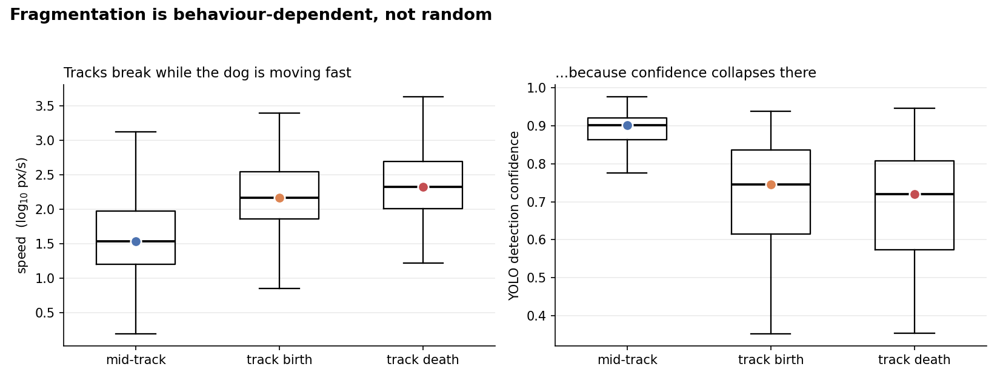
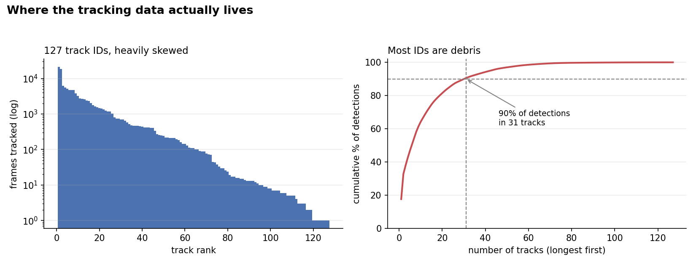

# Tracker diagnostics

Counting track IDs says how badly a tracker fragments. It does not say *why*, or whether
the fragmentation is safe to ignore. This module answers the questions that decide which
downstream behavioural analyses are valid.

```bash
python tracker_diagnostics.py \
    --traj ../02_tracking/results/trajectories_per_frame.csv.gz \
    --summary ../02_tracking/results/summary_metrics_per_dog.csv \
    --outdir figures
```

Writes `figures/diagnostics.json` plus the two figures below.

## What it checks

**1. Concentration.** How much of the data sits in how few tracks. 90% of detections are
in 31 of 127 tracks; the 62 shortest hold under 1%. Most IDs are debris, which is
reassuring rather than alarming.

**2. Break bias — the one that matters.** Compares speed and detection confidence in the
first and last 10 frames of each track against mid-track. Tracks are born at 147 px/s and
die at 212 px/s against 34 px/s mid-track, a **6.2× ratio**, with confidence falling from
0.90 to ~0.72.

Missing data that correlates with behaviour biases every statistic computed from it.
Here, fast bouts are chopped into fragments while slow ones survive intact — so bout
durations and state transitions are biased even though per-frame detection is sound.

**3. Kinematic validity.** Checks derived speeds against physics and against the
tracker's own gaps. Found that speed uses a fixed one-frame timestep even where the
tracker bridged a gap, inflating those 910 rows by a median 5× and producing a reported
maximum of 11,603 px/s — sixteen frame-widths per second.

**4. Coverage.** Instantaneous ID counts against the expected number of dogs. Median 3,
matching the 2–3 visible, with 4.6% of frames over-counting — so the detector is sound
and only across-time linking is broken.

## Figures





## Why this is in the repository

The diagnostics changed the plan. Before running them the next step looked like
"train a re-identification network". Afterwards it was clear that (a) a tracker
configuration fix was the cheaper win, (b) per-window state discovery needs no identity
at all and can start immediately, and (c) transition matrices must wait. Measuring the
failure was worth more than modelling around it.
