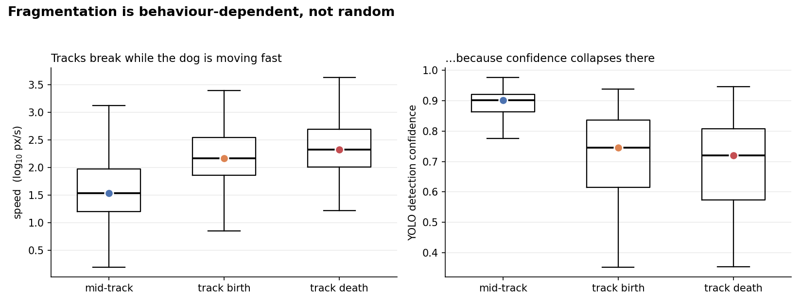
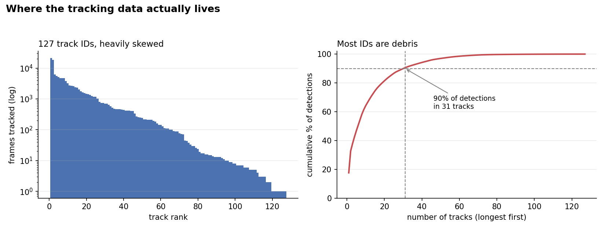

# Automated Behavioural Phenotyping of Group-Housed Dogs

**Status: work in progress.** Detection and tracking are done and quantified. Behavioural
state discovery, posture classification and the dashboard are next. The roadmap below
says exactly where this stands and where it is going.

Turning 15 minutes of enclosure video into per-animal behavioural measurements, without
a human watching the footage.

---

## Why this problem

Behavioural research on animals still runs on **manual ethogram scoring**: a trained
observer watches video and codes what each animal is doing, second by second. It is
slow, it does not scale past a few hours of footage, and two observers rarely agree
perfectly on where one behaviour ends and the next begins.

That bottleneck decides what questions can be asked. A biologist who wants to know
whether a dietary intervention changes how much a group of dogs rests, moves, or
interacts needs continuous observation across many animals and many days — which
is precisely what manual scoring cannot deliver.

An automated pipeline changes the economics: once the detector is trained, a day of
footage is processed in minutes, every frame is scored by the same criteria, and the
output is a numeric time series that standard statistics can be run on. The same
approach transfers to any group-housed animal — kennels, shelters, livestock,
laboratory colonies.

**This project builds that pipeline end to end, and — just as importantly — measures
where it is not yet trustworthy.**

---

## Current state

```
video ──► YOLOv8 detection ──► BoT-SORT tracking ──► kinematics ──► [ behavioural states ]
           done                  done, tuned          done         (next)
                                      │
                                      ├──► tracker diagnostics   done
                                      └──► offline stitching     done
```

| Stage | Status | Where |
|---|---|---|
| Frame extraction + manual annotation (240 frames) | complete | [`01_detection/`](01_detection) |
| YOLOv8 training — nano / medium / large + tuning | complete | [`01_detection/`](01_detection) |
| Multi-object tracking + kinematics | complete | [`02_tracking/`](02_tracking) |
| Tracker failure analysis | complete | [`03_tracker_diagnostics/`](03_tracker_diagnostics) |
| Offline track stitching | complete | [`04_track_stitching/`](04_track_stitching) |
| Unsupervised behavioural state discovery | next | — |
| Posture classification + explainability | planned | — |
| Interactive dashboard | planned | — |

---

## Results so far

### 1. Detection — the smallest model is the right one, but not because it wins

Four YOLOv8 variants, trained on 240 manually annotated frames with a **chronological**
train/val/test split (0–8 min / 8–10 min / 10–15 min) so that adjacent near-duplicate
frames cannot leak across the boundary.

| model | mAP@50 | mAP@50-95 | precision | recall | weights | epochs |
|---|---|---|---|---|---|---|
| nano | 0.972 | 0.537 | 0.939 | 0.948 | 6.2 MB | 80 |
| **nano (tuned)** | 0.981 | **0.606** | 0.989 | 0.958 | **6.2 MB** | 50 |
| medium | **0.992** | **0.608** | 0.990 | **0.967** | 52 MB | 50 |
| large | 0.976 | 0.577 | 0.944 | 0.938 | n/a | 50 |

Reading this honestly: **medium is the most accurate model on every metric.** The useful
result is that the *tuned nano* lands within **0.002 mAP@50-95** of it while being
**8× smaller** (6.2 MB against 52 MB) — which is what makes frame-by-frame inference over 45,000 frames
practical. Nano-tuned is the deployment choice; medium is the accuracy ceiling.

The genuinely interesting finding is that **large is worse than both**. With 240
training images, the biggest model overfits. Hyperparameter tuning on nano bought more
(+0.069 mAP@50-95) than eight times the parameters did.

> ⚠️ The nano baseline ran 80 epochs against 50 for the others, so the nano-vs-nano-tuned
> gap conflates tuning with schedule length. Re-running nano at 50 epochs is on the list.

### 2. Tracking — tuning cut fragmentation by two thirds

Stock `botsort.yaml` assumes roughly 30 fps. This video is **49.95 fps**, so the default
30-frame buffer gave the tracker **0.6 seconds** to re-find a dog through a blur or an
occlusion, with appearance re-identification off.

| metric | default config | tuned config | change |
|---|---|---|---|
| unique track IDs (for 3 dogs) | 377 | **127** | **−66%** |
| new IDs per minute | 25.1 | **8.5** | **−66%** |
| longest unbroken track | 18,458 frames (6.2 min) | **21,424 frames (7.2 min)** | +16% |
| tracks ≤25 frames | 57.3% | **37.8%** | −19.5 pp |
| detection confidence at a track break | 0.57 | **0.73** | bridging harder gaps |
| frames over-counting dogs | 9.1% | **4.6%** | −50% |

**So yes — this is real progress, on five independent metrics, not just the ID count.**
(Measured as *unique* IDs. The highest ID number issued went 1026 → 260, which tells the
same story; unique count is the defensible figure to quote.)

### 3. Diagnostics — what the ID count does not tell you

Fewer IDs is not the same as trustworthy data. Three findings decide which downstream
analyses are valid:



**Fragmentation is behaviour-dependent, not random.** Tracks are born at a median
147 px/s and die at 212 px/s, against **34 px/s mid-track** — a **6.2×** ratio. Detection
confidence at those breaks is 0.72–0.75 versus 0.90 mid-track, and bounding boxes are
nearly twice as large in the fastest speed tercile. The detector is **motion-blur
limited** at 720×576, so the tracker loses dogs precisely when they move fast.

This is the finding that matters, because it is *not* fixed by the tuning above: fast
behavioural bouts get chopped into fragments while slow ones survive intact. Any
bout-duration or state-transition statistic computed on this data is biased, even though
the per-frame detections are fine.



**The debris is harmless; the structure is good.** 90% of all detections sit in 31 tracks
and 50% in just 6. The 62 shortest tracks together hold under 1% of the data. Per-frame
counting is sound — median 3 IDs alive per frame, matching the 2–3 dogs visible, with
only 4.6% of frames over-counting.

**A unit-of-time bug in the kinematics.** Speed is computed as `step_distance / (1/fps)`,
which is only correct when consecutive rows are consecutive frames. On the **910 rows
where the tracker bridged a gap**, several frames elapsed but one frame's worth of time
was used — inflating those speeds by a median of **5×**, and producing a reported maximum
of **11,603 px/s**: a dog crossing the 720-pixel frame sixteen times per second. Mean
speed is barely affected (83.1 → 76.4 px/s), but every per-track **maximum** speed in the
summary table is unreliable. Fixed in the next tracking run.

### What this means for the next phase

| downstream analysis | valid on current data? |
|---|---|
| Per-window behavioural state discovery | **yes** — states are short-timescale, windows sit inside tracks |
| Instantaneous activity levels, space use | **yes** — per-frame detection is sound |
| Bout durations, state-transition matrices | **no** — needs continuous identity |
| Per-individual time budgets (the biologists' question) | **no** — needs identity across the session |

This is why the roadmap puts state discovery before identity: one is already possible,
the other is not.

---

## Roadmap

See [`docs/ROADMAP.md`](docs/ROADMAP.md) for detail.

**Phase 1 — Offline track stitching.** ✅ Done: 127 → 39 IDs, 90% of detections in 16
tracks, zero identity violations. Appearance features and the detector retrain below
should take it further. *See [`04_track_stitching/`](04_track_stitching).*

**Phase 2 — Unsupervised behavioural state discovery.** Sliding-window kinematic features
→ UMAP → HDBSCAN, to find behavioural states without hand-labelling. Each cluster is then
given a human-readable definition by fitting a shallow decision tree on the cluster
labels, so a state is a rule ("speed < 40 px/s and box aspect ≈ 0.9 → resting"), not an
opaque region of an embedding.

**Phase 3 — Posture classification with explainability.** A small CNN on cropped
detections for standing / sitting / lying. Grad-CAM attribution to verify the classifier
uses the *dog* and not the floor underneath it — a realistic shortcut risk when three
animals share one enclosure.

**Phase 4 — Validation against human scoring.** Manually score a held-out window and
measure agreement. Without this the pipeline produces numbers, not evidence.

**Phase 5 — Interactive dashboard.** Upload a video, see tracks, states and time budgets.

---

## Known limitations

- **One video, one enclosure, three dogs.** All 240 training frames come from a single
  15-minute recording. The mAP figures describe performance on *these* dogs under *this*
  lighting and camera angle, and will not transfer to a new site without re-annotation.
- **No ground-truth identities**, so re-identification accuracy cannot yet be measured —
  only fragmentation, which is a proxy.
- **No validated behaviour labels.** Until Phase 4, every behavioural output is
  unvalidated. This is stated rather than hidden.
- **Blur-limited detection** at 720×576 and 50 fps, quantified above. Stitching
  reduces fragmentation but does not remove this bias — a detection never made
  cannot be recovered after the fact.

---

## Repository layout

```
01_detection/            YOLOv8 training, tuning and evaluation  (group project)
  scripts/               dataset prep, train nano/medium/large, hyperparameter tuning
  notebooks/             frame extraction, annotation prep, per-model evaluation
  results/               per-run metrics and curves
02_tracking/             BoT-SORT tracking and kinematics        (my extension)
  notebooks/Tracking.ipynb
  config/                custom_botsort.yaml (used) + recommended next config
  results/               per-frame trajectories, per-track summary, plots
  results_baseline/      the same, from the untuned default config
  kinematics_fix.md      a timestep bug in the speed calculation, and the fix
03_tracker_diagnostics/  failure analysis                        (my extension)
04_track_stitching/      offline re-linking of track fragments   (my extension)
docs/ROADMAP.md
```

Video, extracted frames and annotations are **not** in this repository. The source
material is a single 15-minute recording (720×576, 49.95 fps, 2–3 dogs visible)
provided by the course supervisor; it belongs to the researchers who recorded it.
Model weights are kept in the original project repository.

## Attribution

The detector in [`01_detection/`](01_detection) began as group coursework at Freie
Universität Berlin with **Nikolay Egorov**: frame extraction, manual annotation, and
training the YOLOv8 variants were a shared effort.

Everything from tracking onward — the tracker tuning, kinematics, diagnostics, offline
stitching, and the roadmap — is my own work, extending the detector into a behavioural
phenotyping pipeline.

## Use of this code

This is personal research work, shared for review rather than reuse. No licence is
granted; please ask before building on it.

## Running it

```bash
pip install -r requirements.txt
# failure analysis of the current tracking
python 03_tracker_diagnostics/tracker_diagnostics.py \
    --traj 02_tracking/results/trajectories_per_frame.csv.gz \
    --summary 02_tracking/results/summary_metrics_per_dog.csv \
    --outdir 03_tracker_diagnostics/figures

# re-link track fragments offline
cd 04_track_stitching && python stitch_tracks.py \
    --traj ../02_tracking/results/trajectories_per_frame.csv.gz \
    --out stitched_trajectories.csv
```

Reproducing detection and tracking additionally needs the source video.

---

**Payal Priyadarshini** — MSc Bioinformatics (Data Science), Freie Universität Berlin
